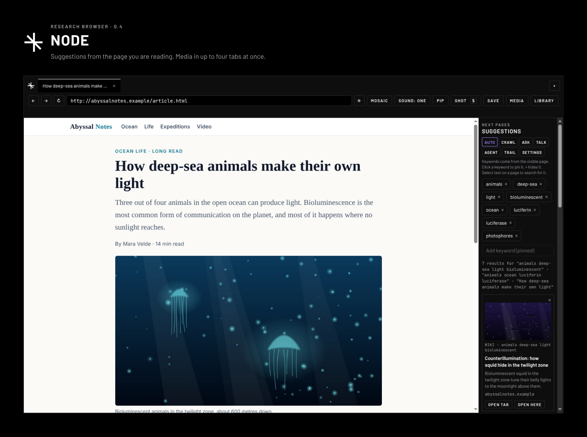
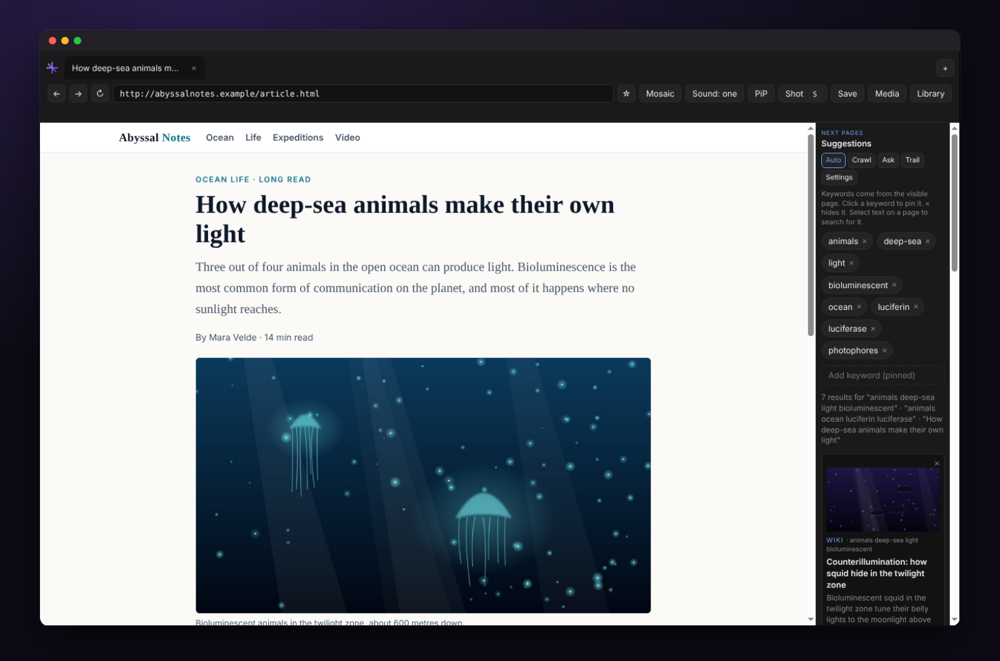
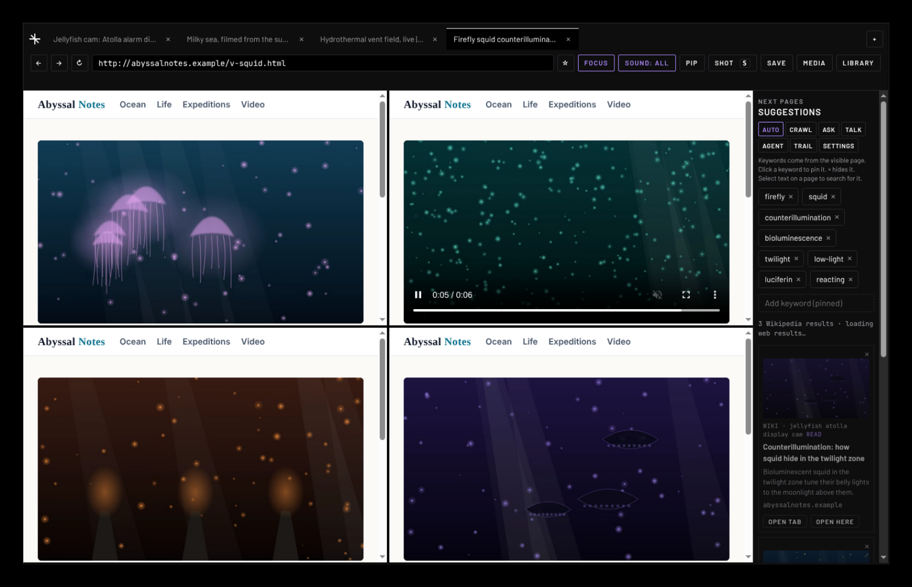
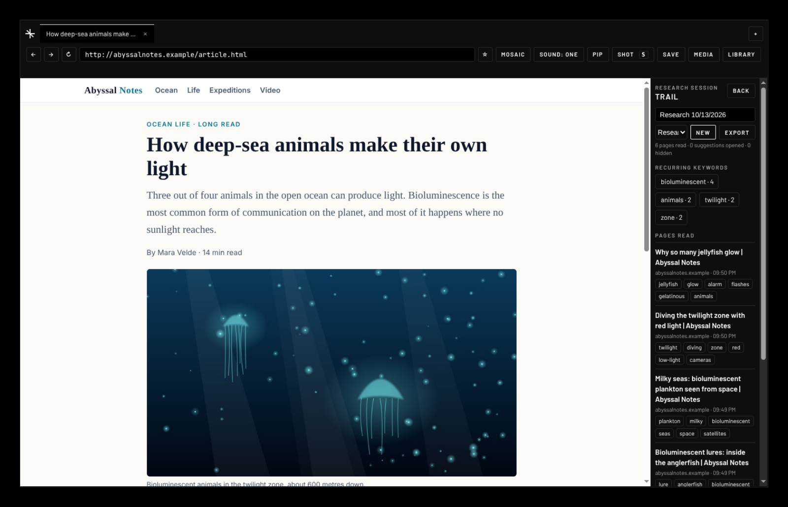

# NODE



NODE is a desktop browser for niche research. It reads the page you are on, picks out its keywords, and suggests the next pages to read in a side panel. Media plays in up to four tabs at once, side by side, and every page you read is kept in a research trail you can export.

Built with Electron and plain JavaScript, with an Expo mobile app (iPhone and Android, in testing) that shares the same core logic. Status: personal project, version 0.4, in active development.

## What it does

| | |
| --- | --- |
| **Suggestions from the page you're reading.** Keywords come from the part of the page in view. Pin a keyword to keep it, × to hide it, or select text to search for it. Results come from Brave Search, Wikipedia, SearXNG or DuckDuckGo, with image previews. |  |
| **Mosaic: four tabs playing at once.** Tile tabs in a grid. Media starts on its own and up to four tabs play together; "Sound: all" lets you hear every one of them. Clicking a video scrolls it to the middle. |  |
| **Research trail.** Every page read in a session, with its top keywords, the keywords that recur across pages, and an export to Markdown. |  |

Also: everyday browser basics (right-click menu, downloads, reopening last session's tabs, sleeping idle tabs, print and PDF), a read-only MCP server so AI agents such as Claude Code can search, read pages and read your research trails ([details](#ai-agents-mcp)), per-site behaviour rules, ad and tracker blocking, bookmarks, picture in picture, trackpad and mouse gestures, Ask AI about a page with a local model, and a separate Google window for Google sign-in. The full list is in [docs/07-features.md](docs/07-features.md).

The interface follows the NODE brand guideline (black ground, Barlow and JetBrains Mono, one violet accent). The screenshots use a fictional site made for them ([docs/media/src](docs/media/src)), so they can be rebuilt with `node docs/media/src/make-shots.js`.

## Project docs

- [Overview](docs/01-overview.md), [roadmap and backlog](docs/02-roadmap-backlog.md), [architecture](docs/03-architecture.md)
- [Review findings](docs/04-review-findings.md), [change log](docs/05-changelog.md), [mobile plan](docs/06-mobile-plan.md)
- [Features and competitor comparison](docs/07-features.md), [engine decision: Electron or Chromium](docs/08-engine-decision.md)

NODE was called Scout until October 2026. The bundle ID `app.scout.browser` and some internal names keep the old name.

## Run

This is a desktop browser (Electron), not a website.

```bash
cd scout   # the folder that holds package.json
npm install
npx electron .
```

`npm start` also works after `npm install`. The first `npm install` downloads Electron into `node_modules` — without that step you get `electron: command not found`.

On macOS the first launch may be blocked by Gatekeeper. If that happens:

```bash
xattr -cr node_modules/electron
npx electron .
```

Requires Node 18+.

**Shot** (or press **S** anywhere outside a text field) captures the active tab into a real folder on this computer and stores the page URL. **Library → Open source** goes back to that page. **Show folder** opens the directory in Finder or Explorer. **Save** writes a JSON note of the page. **Media** downloads the largest video or image currently in view (streamed video such as YouTube cannot be saved as one file).

### Shortcuts

| Keys | Action |
| --- | --- |
| Cmd/Ctrl+T | New tab |
| Cmd/Ctrl+W | Close tab |
| Cmd/Ctrl+L | Focus the address bar (suggests pages from history as you type) |
| Cmd/Ctrl+R | Reload |
| Cmd/Ctrl+[ and ] | Back, forward |
| Cmd/Ctrl+F, Cmd/Ctrl+G, Shift+Cmd/Ctrl+G | Find in page, next match, previous match |
| Cmd/Ctrl+= , Cmd/Ctrl+-, Cmd/Ctrl+0 | Zoom in, out, reset (pinch and Ctrl+scroll also work) |
| Cmd/Ctrl+Y | History |
| Cmd/Ctrl+Shift+M | Mosaic on or off |
| Cmd/Ctrl+Shift+A | Sound from all playing tabs, or only the current one |
| Cmd/Ctrl+D | Bookmark the page |
| Cmd/Ctrl+Shift+B | Bookmarks |
| Cmd/Ctrl+Shift+P | Picture-in-picture |
| Cmd/Ctrl+Shift+U | Mute or unmute the tab |
| Cmd/Ctrl+Shift+S, or S | Screenshot the tab |

## Repository layout

| Folder | What it is |
| --- | --- |
| `core/` | Logic shared by desktop and mobile (keywords, search sources, AI, rules, sessions, history, page scripts). See `core/README.md` |
| `renderer/`, `main.js`, `preload.js`, `view-preload.js`, `fs-storage.js` | Desktop app (Electron) |
| `mobile/` | Mobile app (React Native, Expo) walking skeleton. See `mobile/README.md` |
| `test/` | Unit demos and desktop end-to-end tests |
| `docs/` | Overview, roadmap, architecture, review findings, change log, mobile plan |

## Mobile

The mobile app is planned with React Native (Expo) and reuses `core/`. A first version is in `mobile/`: try it on your phone with the Expo Go app (`cd mobile && npm install && npx expo start`, then scan the QR code). The plan is in `docs/06-mobile-plan.md`.

The old Tauri setup (`src-tauri/`, `renderer/tauri-bridge.js`) does not compile and will be removed.

## How it works

1. Each tab is an Electron `WebContentsView`, a real Chromium page. Tabs that are not on screen are detached from the window, so Chromium stops drawing them and slows their timers; their media keeps playing. In Mosaic every tile is on screen, so several videos play together.
2. **Mosaic** tiles every open tab. Click a tile to make it the current tab. **Focus** shows one tab at full size.
3. **Playing in several tabs:** media autoplays in every tab, and up to 4 tabs play at once. When a fifth tab starts, the tab that started playing longest ago is paused and marked ⏸ in the tab bar (the active tab is never paused this way). Opening a paused tab resumes it.
4. **Sound:** by default only the active tab is audible and other tabs keep playing muted. The **Sound: one / Sound: all** button in the toolbar (or Cmd/Ctrl+Shift+A) makes every playing tab audible at once. The speaker button on a tab overrides this; right-click it to go back to automatic.
5. **Autoplay** is allowed without a prior click. As soon as a page is parsed, NODE plays its main media with sound: the largest visible video or YouTube, Vimeo or Dailymotion embed, or else the first audio player. Players that appear later (built by a script, or on sites like YouTube that change address without reloading) are caught for 20 seconds. Only the main player starts, and media you pause stays paused.
6. **Center on click:** clicking a video, an image or an embedded player (YouTube, Vimeo and similar) smoothly scrolls the page so it sits in the middle of the view. Small images such as icons are ignored. Site rule `center` turns it off per site.
7. **Popups** open as a new tab only if you clicked or typed in the page in the previous 2 seconds. Other popups are blocked and listed in the sidebar with an "Open in new tab" button.
8. **Permissions:** camera, microphone, location, notifications, clipboard reading and screen capture always ask first. Answers can be remembered per site (File → Reset Site Permissions clears them).
9. **Keywords** (`keywords.js`): NODE reads the page title, description, headings, selected text and the text currently on screen (navigation and footers skipped). Words are scored by where they appear, how specific they are, and how rare they are across the pages you have visited this session. Multi-word names ("Marie Curie") are kept together.
10. **Pin and hide:** click a keyword to pin it; pinned keywords go into every search and are never replaced. × hides a keyword for good (Show all brings them back).
11. **Search:** pins and the top keywords become 2 or 3 short queries (at most 4 words each). Wikipedia runs for every query. Web results come from the first working source in this order: Brave Search API (the default; needs your API key), SearXNG, DuckDuckGo. Searches typed in the address bar open Brave Search (search.brave.com). A source that rejects a key, hits a rate limit or starts blocking is paused for a while and the next one is used. Results are cached for 30 minutes and requests are spaced out per site.
12. **Results** show Wikipedia first, within about a second; web results are merged in when they arrive.
13. **Previews** on result cards load only when a card scrolls into view, 3 at a time. Wikipedia and Brave results that already include an image skip the fetch.
14. **Auto** re-searches when you open a new page, select text, or scroll to content with different keywords (at most every 20 seconds). Turn Auto off to search only when you press **Crawl**.

## Bookmarks, picture-in-picture, ad blocking and Ask AI

- **Bookmarks.** ☆ next to the address bar (or Cmd/Ctrl+D) bookmarks the page; ★ means it is saved. Bookmarks appear first in address-bar suggestions and in the Bookmarks shelf of the Library (Cmd/Ctrl+Shift+B).
- **Picture-in-picture.** PiP in the toolbar (or Cmd/Ctrl+Shift+P) puts the page's video, or an embedded YouTube or Vimeo player, in a floating window. Again to close it.
- **Ad and tracker blocking.** On by default, using the EasyList and EasyPrivacy lists (Ghostery's filter engine), downloaded on first run and updated weekly. Turn it off in Settings, or for one site with a site rule `"adblock": false`. Settings shows how many requests were blocked.
- **Ask AI.** Ask in the sidebar opens a chat about the current page, with Summarize, Key facts and What next? buttons. It uses the model set up under Settings → AI (a local model or Grok). Questions send the page's readable text, title and address to that model; nothing is sent until you ask.

## Installing

Build an installer on the computer it is for:

```bash
npm install
npm run dist:mac    # macOS: dist/NODE-0.4.0-arm64.dmg (or x64 on Intel Macs)
npm run dist:win    # Windows: dist/NODE Setup 0.4.0.exe
```

The app is not signed with an Apple Developer ID yet, so the first time macOS says it cannot check the app: right-click NODE in Applications, choose Open, then Open. Automatic updates need a signed app and a download host; they come later.

## Gestures

Desktop:

| Gesture | Action |
| --- | --- |
| Two-finger swipe right / left on a trackpad | Back / forward. An arrow at the edge of the page fills as you swipe; let go when it turns blue. Not triggered inside areas that scroll sideways |
| Three-finger swipe (macOS, if set in System Settings) | Back / forward |
| Mouse side buttons | Back / forward |
| Pinch, or Cmd/Ctrl + scroll | Zoom |
| Middle-click or Cmd/Ctrl+click a link | Open it in a new background tab |
| Middle-click a tab | Close it |
| Double-click the empty part of the tab bar | New tab |
| Drag a tab | Reorder tabs (also the Mosaic order) |
| Click a video, image or embedded player | Scroll it to the middle of the view |

Mobile:

| Gesture | Action |
| --- | --- |
| Swipe left / right on the address bar | Next / previous tab |
| Swipe from the screen edge (iPhone) | Back / forward |
| Android back button | Back |
| Pull down at the top of a page (iPhone) | Reload |
| Press and hold the tab count | New tab |
| Swipe a tab left in the tab list | Close it |
| Pinch | Zoom the page |
| Tap a video, image or embedded player | Scroll it to the middle |

## Research sessions

**Trail** in the sidebar shows the current research session: every page you read (with its top keywords), keywords that recur across pages, and how many suggestions you opened or hid. Click a keyword to pin it. Pinned keywords are saved with the session.

On result cards, **×** hides a result for the rest of the session, and results you have already opened or read are dimmed and marked "read". **New** starts a fresh session; the dropdown switches back to an older one. **Export** saves the session as Markdown notes in the Library (Saves).

## Talk

**Talk** in the sidebar shows existing discussion of the page you are reading: Hacker News stories and Bluesky posts that link to it, plus a link to search Reddit. NODE looks the page up only while Talk is open, sends its address without tracking parameters, and never looks up sign-in, account, payment or banking pages or addresses on your own network. Turn it off for a site with the site rule `"talk": false`. This is stage 1 of the social layer plan; posting and accounts come later.

## Research agent

**Agent** in the sidebar asks for a question, then runs a few searches with your sources, reads the best results in a separate logged-out session, searches once more if its notes leave gaps (8 pages at most) and writes a short report with numbered sources. A small live view shows the page it is reading, and you can ask follow-up questions that build on the sources it already read. You see each step as it happens and can stop it. The report is saved to the Library and the research session, and **Open sources in Mosaic** opens the sources side by side. It uses the model set in Settings → AI.

It is tested against 12 prompt-injection pages before each release (`npm run test:redteam`), including with a model that obeys them. It only reads pages that came back from its own searches: the model picks results by number and never supplies an address, so hidden text on a page cannot send it somewhere else. It does not sign in, click or fill forms, and skips pages that ask for a password or card details.

## AI agents (MCP)

NODE can serve AI agents on your computer, such as Claude Code, Codex or Cursor, through the Model Context Protocol. It is off by default and read-only.

1. Settings → **Agent access (MCP)** → tick **Let AI agents on this computer use NODE**.
2. Copy the command shown and run it in Terminal. For Claude Code it looks like:

   ```bash
   claude mcp add --transport http node http://127.0.0.1:47615/mcp --header "Authorization: Bearer <token>"
   ```

   Other clients take the same address and header in their MCP settings.
3. To let an agent read a page you have open, click **Share tab** in the toolbar. Sharing ends when the tab goes to another site.

What agents can do:

| Tool | What it does |
| --- | --- |
| `search_web` | Searches with your NODE sources (Brave, Wikipedia, SearXNG, DuckDuckGo) |
| `fetch_page` | Reads a public page as Markdown in a separate, logged-out session that never sees your logins |
| `list_shared_tabs`, `read_tab` | Lists and reads only the tabs you shared |
| `list_research_sessions`, `get_research_session` | Your research trails as Markdown (also available as resources `node://sessions/...`) |

Limits enforced by NODE, not by the agent: no clicking, typing or signing in; sign-in, account, payment and banking pages and pages with password or card fields are never read; addresses on your computer or local network are refused; only programs with the token can connect, and web pages cannot; calls are rate-limited. Every call is listed in Settings and saved in the research session. **Agents ●** in the toolbar (or View → Stop All Agents) turns the server off and takes back every shared tab.

## Site rules

Settings → **Site rules** lists the rules in plain words. **Rule for this site** starts one for the page you are on; every setting can be left as "Same as before" so earlier rules still apply. Rules are saved to `rules.json`, which you can still edit by hand (Edit rules file).


NODE reads `rules.json` (File → Edit Site Rules…, or Settings → Edit rules file) and reloads it when you save. Each rule has a `match` and any of these settings:

| Setting | Values | Effect |
| --- | --- | --- |
| `autoplay` | `on`, `muted`, `off` | Start media on load, start it muted, or pause media the page starts before you interact |
| `sound` | `auto`, `on`, `off` | Default sound for tabs on this site (the speaker button still overrides it) |
| `popups` | `gesture`, `block`, `allow` | Popups only after a click, never, or always |
| `suggest` | `true`, `false` | `false` stops NODE reading the page for keywords or sending its words to search |
| `mosaic` | `true`, `false` | `false` keeps the site out of the Mosaic grid unless it is the active tab |
| `center` | `true`, `false` | `true` (default): clicking a video, image or embedded player scrolls it to the middle of the view. `false` turns this off for the site |
| `adblock` | `true`, `false` | `true` (default): block ads and trackers. `false` allows them on the site |
| `extract.include`, `extract.skip` | lists of CSS selectors | Extra text to read with priority; areas to ignore |

`match` can be `example.com` (with subdomains), `*.example.com` (subdomains only), `example.com/path`, a list of these, `*` for every site, or a regular expression like `/\/login/i`. Rules apply in order and later matches win. The first run creates examples for Wikipedia, YouTube, and sign-in, banking and payment pages (no suggestions, no autoplay). A broken file is reported in the sidebar and the previous rules stay in use.

## AI query ideas

Optional (Settings → AI query ideas). An AI model reads your pinned keywords, the page's top keywords and its title, and suggests up to 2 extra search queries that look for other angles: background, related people or organisations, primary sources, opposing views. The status line marks these queries "(AI)". Keyword-only results still show first, so the AI never slows down the first results.

| Option | Setup | Privacy |
| --- | --- | --- |
| Local model | Install [Ollama](https://ollama.com) and run `ollama pull llama3.2` (or any chat model). Address `http://localhost:11434/v1`. LM Studio also works at `http://localhost:1234/v1`. | Nothing leaves your computer |
| Grok (xAI) | API key from xAI. Press **Test** to see the model names your key can use and pick one. | Keywords and page titles are sent to xAI |

The model never receives page text or addresses, and pages with suggestions turned off by a site rule are never sent. If the model is unreachable or answers badly, NODE uses its normal keyword queries and shows a note. The Grok key is stored like the search keys (encrypted with the system keychain when available).

## Search sources

Open **Settings** in the sidebar to turn sources on or off. **Test** runs one search with that source and shows the result or the error.

| Source | Setup | Notes |
| --- | --- | --- |
| Wikipedia | Nothing. Optional language code (en, es, fr…) | Always runs; gives the reference results |
| Brave Search API | API key from the Brave Search API dashboard (api-dashboard.search.brave.com) | Default web source, on from the start. Best web results; has a free tier with a monthly limit. Without a key, DuckDuckGo is used |
| SearXNG | URL of an instance you run or trust, with the `json` format enabled in its `settings.yml` | No key; you control the engines |
| DuckDuckGo | Nothing | Fallback only. Reads the HTML results page, so it can break or be rate-limited |

API keys are stored in NODE's `settings.json`, encrypted with the system keychain when one is available.

## What this is not

It is not a general-purpose crawler, scraper farm, or archive bot. It only suggests a short list of next URLs from a keyword query against public search. It does not log in, bypass paywalls, or walk an entire site unattended.
